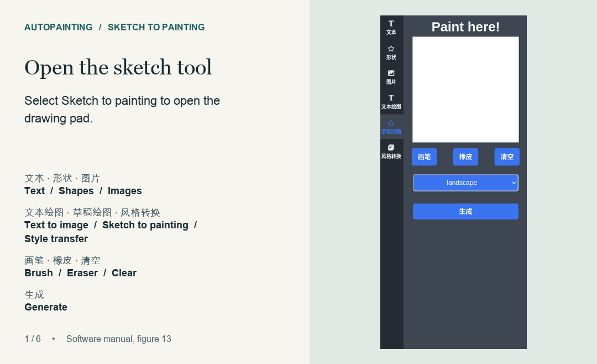
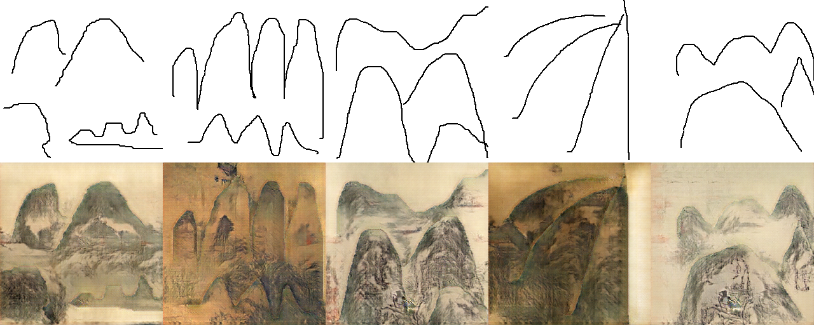
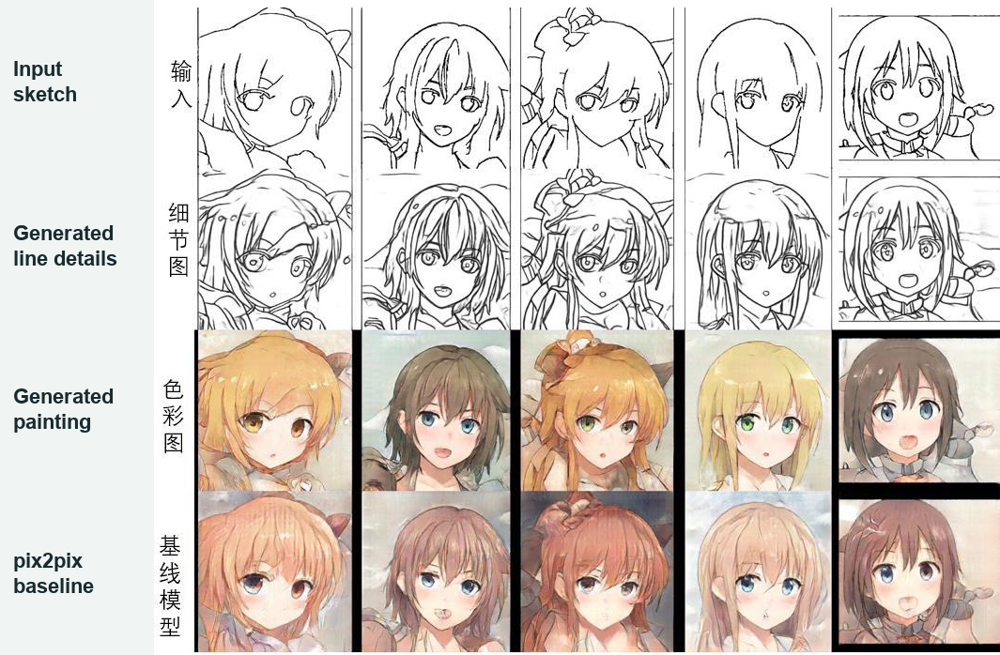
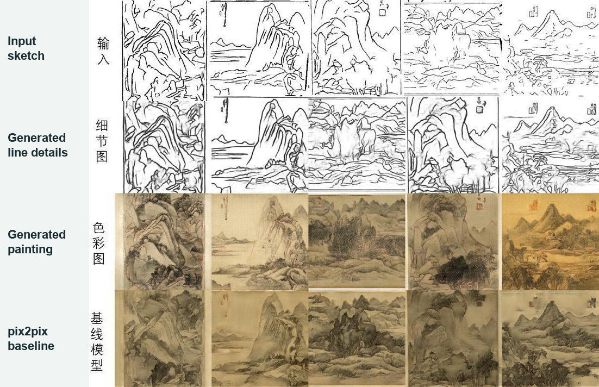

# AutoPainting

AutoPainting is a web-based graphic design editor where users turn rough sketches into paintings and arrange them alongside text, shapes, and photos on a canvas.

Draw sketches. Generate. Save the generated painting to **My images**, click its thumbnail to add it to the canvas, then drag it into position. [Product walkthrough (PDF)](product-walkthrough.pdf)

## Sketch to Painting

Two conditional GANs turn a rough sketch into an anime portrait or a Chinese landscape. The first develops the sketch into a detailed line drawing. The second uses that drawing to guide color generation and preserve the composition.

1. **Detail generation.** Starting from the rough sketch, a generator with six residual blocks adds visual details that fit the composition. A few strokes marking a mountain ridge can become a line drawing with rock faces and foliage.
2. **Color generation.** A U-Net takes that detailed drawing as input and paints it in color. Skip connections preserve the arrangement of the forms, while a PatchGAN critic evaluates local texture. Training combines Wasserstein adversarial, L1 pixel, VGG16 feature, and total variation losses.

[Read the thesis for the model architecture and experiments (PDF)](thesis.pdf)

A large language model (LLM) translated both the product walkthrough and the thesis directly from the original Chinese into English.

### Generalization to real hand-drawn sketches

Each column pairs a freehand sketch (top) with the landscape generated from it (bottom). These five examples test how the model responds to human strokes after training on sketches derived from paintings. *Thesis figure 5-20.*

### Held-out test-set results

For both datasets below, the input sketches were derived from held-out images using edge detection and morphological filtering. The two-stage model and pix2pix received the same inputs. The table reports mean Inception Score ± standard deviation on these test sets.

| Dataset | Source images | pix2pix | Two-stage model | Relative gain |
| --- | ---: | ---: | ---: | ---: |
| Anime Lit | 25,000 | 1.59 ± 0.01 | **2.13 ± 0.02** | +33.96% |
| Chinese landscapes | 3,400 | 2.34 ± 0.13 | **2.60 ± 0.06** | +11.11% |

#### Anime Lit test set

Follow one portrait down the column. The sketch establishes the pose and hairstyle, the detail stage draws facial features and individual strands, and the color stage assigns hair and skin tones. The bottom row shows pix2pix on the same input. *Thesis figure 5-17.*

#### Chinese landscape test set

The first two rows show how the model develops a mountain outline into ridges, rocks, and vegetation. The third row shows the color stage’s treatment of those forms, with the pix2pix result directly below. *Thesis figure 5-16.*

